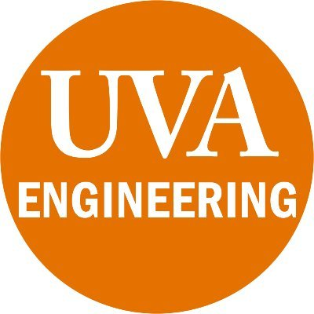
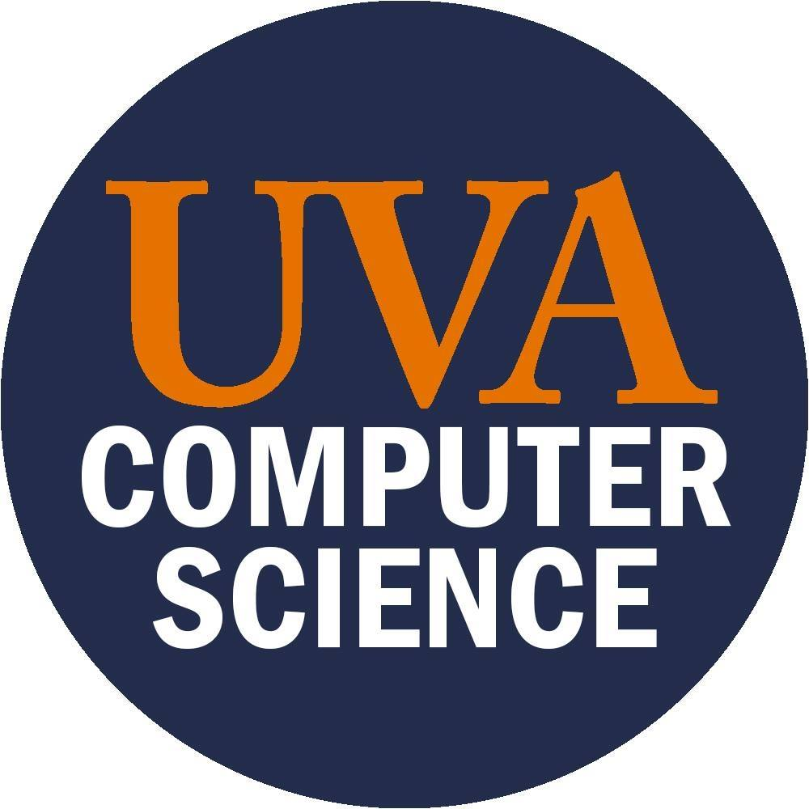

<!--- img style='height: 100%; width: 100%; object-fit: contain' src="thornton-hall.jpeg"/ --->

# UVA LLM Workshop on Agentic and Generative AI for Science and Engineering

## Workshop Overview

We are excited to invite you to the upcoming **UVA LLM Workshop on Agentic and Generative AI for Science and Engineering**. Now in its **third year**, the UVA LLM Workshop series returns with a dedicated focus on **agentic AI and its impacts on science and engineering research and practice**.

As generative AI models, autonomous AI agents, multi-agent collaboration, and tool-augmented reasoning frameworks continue to transform research across computer science, bioengineering, robotics, materials science, and physical systems, this workshop aims to bring together researchers from the School of Engineering and Applied Science and schools across the UVA to share ongoing work, spark interdisciplinary collaborations, and discuss future directions in generative and agentic AI.

Whether you are developing core generative foundation models and agentic reasoning architectures, applying generative AI to domain-specific scientific and engineering challenges, or evaluating safety, verification, and alignment, we welcome your participation!

## Dates and Location

- Date: October 30, 2026
- Time: 9 AM - 4 PM
- Location: [Newcomb Hall Theatre](https://studentaffairs.virginia.edu/subsite/event-management/student-activity-spaces/newcomb/newcomb-hall-theatre)

## Organizers

- Yangfeng Ji (CS)
- Prasanna Balachandran (MSE/MAE)
- Meiqin Li (APMA)
- Sara Riggs (SIE)

**Contact the organizers**

Email to yangfeng@virginia.edu

## Acknowledgment

This workshop is supported by the UVA Engineering Research Interest Group (RIG) program.
The workshop logistics are made possible via the support of the CS department.

  
  

## Past Workshop

- [UVA LLM Workshop 2024](2024/README.md)
- [UVA LLM Workshop 2025](2025/README.md)
